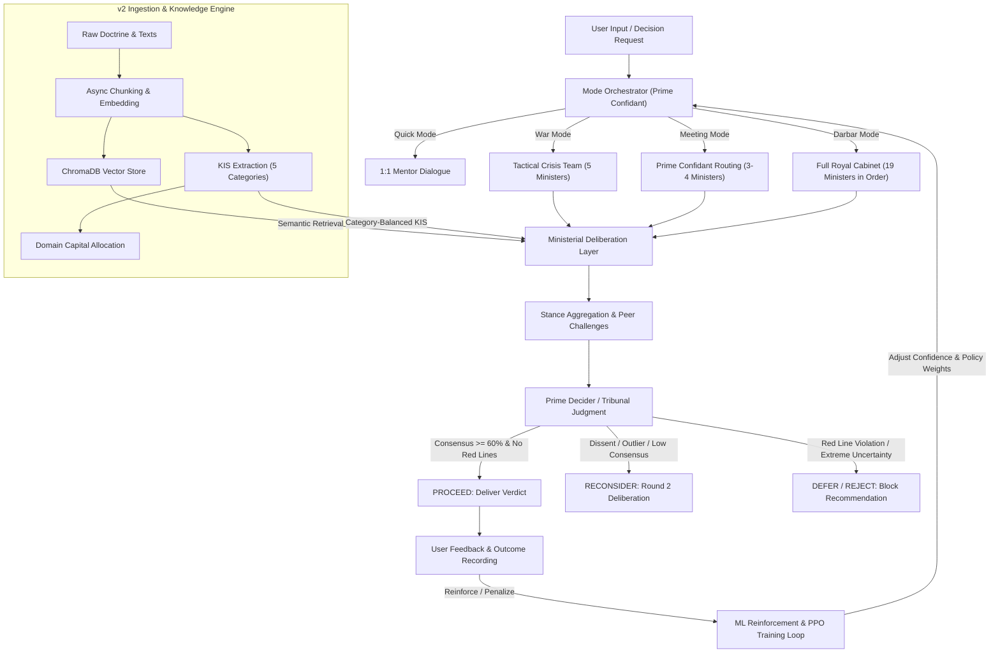
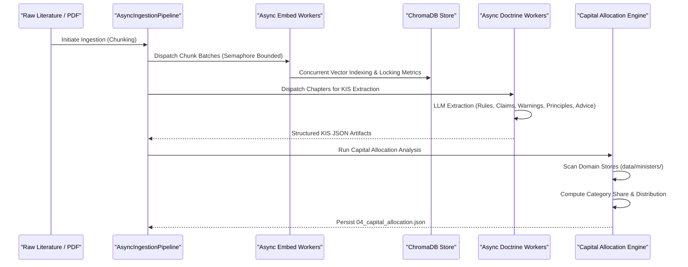
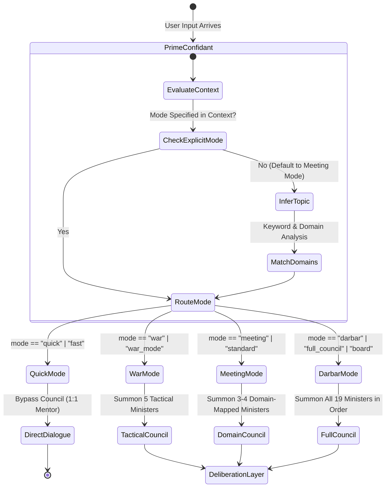
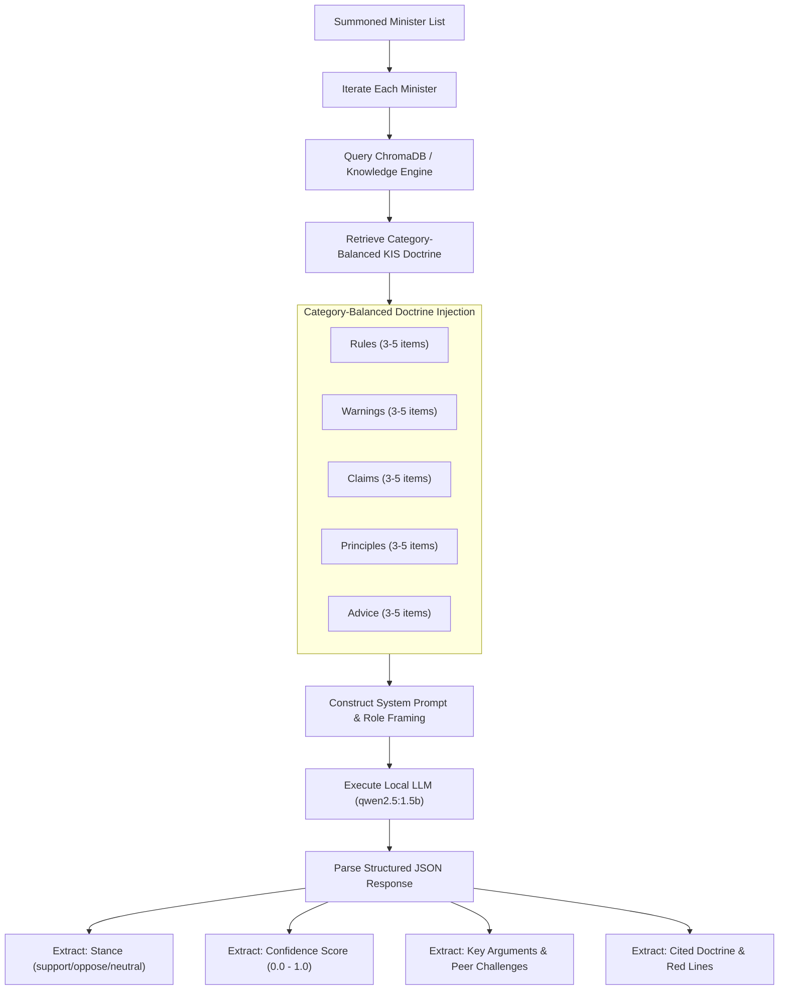
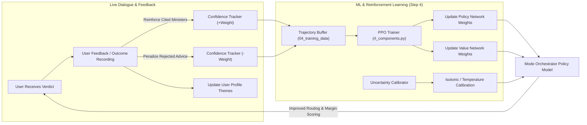

# ERA (Epistemic Reasoning Architecture) Pipeline, Flow & Transitions

This document provides the definitive, comprehensive technical documentation for the **ERA (Epistemic Reasoning Architecture)** system. It details the end-to-end data pipelines, mode orchestration routing, ministerial summoning flows, dialectical deliberation mechanics, state transitions, and continuous reinforcement learning loops.

---

## 1. System Architecture & Philosophy

ERA is an advanced agentic decision-making and advisory architecture designed to deliver multi-perspective, doctrine-compliant, and self-improving counsel. Rather than relying on simple heuristics or monolithic LLM prompting, ERA structures reasoning through a **Royal Cabinet (Darbar)** of specialized ministerial personas, governed by a **Prime Confidant** (mode orchestrator and routing engine) and judged by a **Prime Decider** against strict epistemic and ethical red lines.

### Core Architectural Layers
1. **Ingestion & Knowledge Layer (v2)**: Asynchronous, concurrent ingestion of raw texts, vector embedding generation, and LLM-driven Knowledge Item Synthesis (KIS) extraction.
2. **Knowledge Retrieval Layer (ChromaDB + KIS Engine)**: Semantic retrieval of category-balanced doctrine (`Rules`, `Claims`, `Warnings`, `Principles`, `Advice`).
3. **Routing & Mode Orchestration Layer (Prime Confidant)**: Dynamic topic analysis and routing across 4 operational modes (`Quick`, `War`, `Meeting`, `Darbar`).
4. **Ministerial Deliberation Layer (19 Specialized Ministers)**: Independent persona evaluation, stance formation, confidence scoring, and peer challenging via local LLMs (`qwen2.5:1.5b`).
5. **Synthesis & Judgment Layer (Prime Decider / Tribunal)**: Weighted vote aggregation, consensus calculation, red-line enforcement, and state transition judgment.
6. **Self-Improvement & ML Reinforcement Layer**: Continuous feedback loops, PPO reinforcement learning, policy/value network updates, and uncertainty calibration.



---

## 2. Ingestion v2 Pipeline & Capital Allocation Flow

The v2 ingestion engine (`ingestion/v2/src/`) transforms unstructured foundational literature into structured, vector-indexed, and domain-allocated knowledge stores using asynchronous concurrency.

### Detailed Pipeline Stages



1. **Async Chunking & Embedding (`async_ingest_orchestrator.py`)**:
   - Documents are split into semantic chunks with configurable overlap.
   - Vector embeddings are generated concurrently across worker threads using `asyncio.Semaphore(num_embed_workers)` and `asyncio.to_thread`.
   - Thread-safe telemetry is maintained via `asyncio.Lock` inside `IngestMetrics`.

2. **Async Doctrine KIS Extraction (`async_doctrine_workers.py`)**:
   - For each chapter or section, concurrent LLM workers extract **Knowledge Item Synthesis (KIS)** entries across 5 distinct categories:
     - `Principles`: Core immutable truths governing the domain.
     - `Rules`: Strict operational directives and boundaries.
     - `Claims`: Empirical assertions and historical precedents.
     - `Warnings`: Identified failure modes, risks, and anti-patterns.
     - `Advice`: Actionable, prescriptive guidance.
   - Extraction tasks are orchestrated via `asyncio.gather(*tasks)` while preserving strict document order.

3. **Capital Allocation & Domain Analytics (`capital_allocation.py`)**:
   - Post-processing scans all ministerial domain stores under `data/ministers/`.
   - Computes total knowledge capital allocated per minister, category distribution ratios, and knowledge gap sparsity metrics.
   - Persists the comprehensive audit report to `04_capital_allocation.json`.

---

## 3. Mode Orchestration & Prime Confidant Routing

When a user request enters ERA, the **Mode Orchestrator** (`ModeOrchestrator` in `mode_orchestrator.py`) acts as the **Prime Confidant**, determining the operational framing and selecting the precise subset of ministers required.

### Mode Transition State Machine



### 100% Minister Utilization Mapping (19 Ministers)

To ensure comprehensive domain coverage without redundancy, the Prime Confidant maps topics across 13 specialized domains, activating all **19 specialized ministers**:

| Domain Tag | Keyword Triggers | Summoned Ministers (3-4) |
| :--- | :--- | :--- |
| **`career`** | job, career, work, promotion, hire, salary, employer, office | `Grand Strategist`, `Psychology`, `Timing` |
| **`financial`** | money, loan, invest, finance, debt, savings, capital, cost, budget | `Risk`, `Optionality`, `Data`, `Resources` |
| **`relationships`** | friend, partner, relationship, family, social, team, marriage | `Diplomacy`, `Psychology`, `Legitimacy`, `Narrative` |
| **`health`** | health, diet, sleep, exercise, stress, doctor, medical | `Psychology`, `Timing`, `Risk`, `Adaptation` |
| **`strategy`** | strategy, plan, goal, business, company, market, startup, venture | `Grand Strategist`, `Intelligence`, `Timing`, `Optionality` |
| **`power`** | power, negotiate, win, dominate, aggressive, fight, leverage, compete | `Power`, `Diplomacy`, `Conflict`, `Sovereign` |
| **`ethics`** | legal, law, ethics, honest, truth, rule, policy, court | `Legitimacy`, `Truth`, `Discipline`, `Sovereign` |
| **`innovation`** | tech, software, code, ai, platform, system, app, data, server | `Technology`, `Grand Strategist`, `Risk`, `Adaptation` |
| **`resilience`** | change, pivot, adapt, transition, resilience, flexibility, crisis, shift | `Adaptation`, `Risk`, `Optionality`, `Discipline` |
| **`communication`** | story, brand, reputation, public, media, communicate, pitch, pr | `Narrative`, `Diplomacy`, `Truth`, `Psychology` |
| **`resources`** | resource, asset, inventory, supply, capacity, time, energy, allocation | `Resources`, `Data`, `Risk`, `Grand Strategist` |
| **`leadership`** | freedom, independence, autonomy, control, own, leader, govern | `Sovereign`, `Power`, `Discipline`, `Legitimacy` |
| **`crisis`** | war, emergency, survival, battle, attack, defend, threat, win | `War Mode`, `Conflict`, `Risk`, `Adaptation`, `Timing` |
| *(Default Fallback)* | *(No domain matched / general inquiry)* | `Risk`, `Grand Strategist`, `Optionality`, `Psychology` |

---

## 4. Ministerial Deliberation & KIS Injection Flow

Once the Prime Confidant summons the required ministers, execution flows to `NativeCouncil.deliberate()` (`engine.py`) and invokes `MinisterVoice` (`minister_voice.py`).

### Dialectical Deliberation & Doctrine Injection



1. **Category-Balanced Retrieval**: For each minister, the knowledge engine retrieves semantic matches from ChromaDB, explicitly grouping and balancing them across all 5 KIS categories to ensure the LLM receives structured constraints, empirical claims, and prescriptive advice.
2. **Structured LLM Deliberation**: The minister evaluates the user's dilemma against their specific persona instructions and injected doctrine, returning a strict JSON payload containing their stance, confidence, reasoning, peer challenges, and red-line alerts.

---

## 5. Synthesis, Judgment & State Transitions

After all summoned ministers report their stances, the **Prime Decider** (`PrimeDecider` and `_llm_deliberate` in `engine.py`) aggregates the votes and governs state transitions.

### Judgment Transition Flowchart

```mermaid
flowchart TD
    A["Collect All Minister Positions"] --> B["Compute Weighted Vote Stances"]
    B --> C["Check Red Line Triggers"]
    
    C -->|Red Line Triggered!| D["VIOLATION: Legitimacy / Truth / Harm"]
    D --> E["STATE TRANSITION: DEFER / REJECT"]
    E --> F["Output: Recommendation Blocked + Warning"]
    
    C -->|No Red Lines| G["Calculate Consensus Strength & Entropy"]
    G --> H{"Consensus Ratio >= 60%?"}
    
    H -->|Yes| I["Check Minority Outliers"]
    I -->|No High-Confidence Opposing Outlier| J["STATE TRANSITION: PROCEED"]
    J --> K["Output: Synthesized Verdict & Action Plan"]
    
    H -->|No (< 60% Consensus)| L["STATE TRANSITION: RECONSIDER"]
    I -->|High-Confidence Outlier Detected| L
    
    L --> M{"Is Mode == Darbar & Round == 1?"}
    M -->|Yes| N["Initiate Round 2 Dialectical Debate"]
    N --> O["Inject Peer Challenges into Round 2 Prompts"]
    O --> A
    
    M -->|No / Round 2 Complete| P["Output: Present Balanced Tradeoffs & Request User Clarification"]
```

### Transition States & Verdicts
- **`PROCEED`**: The council has reached a strong, doctrine-compliant consensus ($\ge 60\%$) with no red-line violations or unresolved outlier objections. The final synthesized wisdom is delivered to the user.
- **`RECONSIDER`**: Triggered by split votes, high decision entropy, or a high-confidence minority outlier challenging the majority. In **Darbar Mode**, this automatically triggers a **Round 2 Dialectical Debate**, where ministers are re-summoned and presented with their peers' counter-arguments and challenges. In other modes, it surfaces the tradeoffs clearly to the user.
- **`DEFER / REJECT`**: An absolute block triggered when any minister flags a **Red Line Violation** (e.g., illegal acts, deception, existential financial ruin, or physical harm). The Prime Decider halts all affirmative recommendations and issues an explicit doctrine warning.

---

## 6. Self-Improvement & ML Reinforcement Loop

ERA is not static; it continuously adapts and sharpens its ministerial judgment through an integrated machine learning and reinforcement feedback loop.

### Continuous Reinforcement Pipeline



1. **Live Feedback & Weight Adjustment (`confidence_tracker.py`, `api.py`)**:
   - When a user accepts a verdict or cites specific ministerial advice, the API triggers reinforcement, boosting those ministers' historical confidence weights for future routing.
   - Conversely, rejected advice or negative feedback penalizes the contributing ministers' weights.
   - User profile themes (`user_profile.py`) are updated dynamically to reflect evolving user risk tolerance and preferences.

2. **PPO Training & Policy Refinement (`training_loop/`, `rl_components.py`)**:
   - Decision trajectories, minister stances, consensus margins, and user feedback are logged into trajectory buffers (`04_training_data`).
   - A **Proximal Policy Optimization (PPO)** trainer periodically trains on these buffers, updating the neural policy and value models that guide mode selection and uncertainty estimation.
   - **Uncertainty Calibration** (`uncertainty_calibration.py`) applies temperature scaling and isotonic regression to ensure the Prime Confidant's predicted confidence accurately reflects empirical success rates.

---

## 7. Complete Verification & Audit Reference

This architecture and pipeline have been fully verified against automated regression suites, confirming 0 regressions across all execution modes:

- **Ingestion & Embedding Concurrency**: Verified via `test_async_embed.py` and `test_async_embed_debug.py`.
- **Prime Confidant Routing & Deduplication**: Verified via `test_prime_decision.py` and `test_prime_decision_package.py`.
- **100% Minister Utilization & Darbar 2-Round Execution**: Verified via `test_era_upgrades.py` (`test_domain_routing_activates_only_relevant_ministers`, `test_darbar_mode_runs_two_rounds`, `test_native_council_uses_llm_voice_in_meeting_mode`).
- **ML Reinforcement & PPO Loop**: Verified via `test_rl_components.py` and `test_step4_training_data.py`.
